# Typst calender component

Declare calendar events and render them the way you want.

## Usage

Every image below is rendered from [usage.typ](usage.typ), with the code shown under it.
The first two sections declare the calendars `c1` to `c4` (and `colors`) that the following ones reuse.

### Declaring data: marks and spans, then generating them with loops

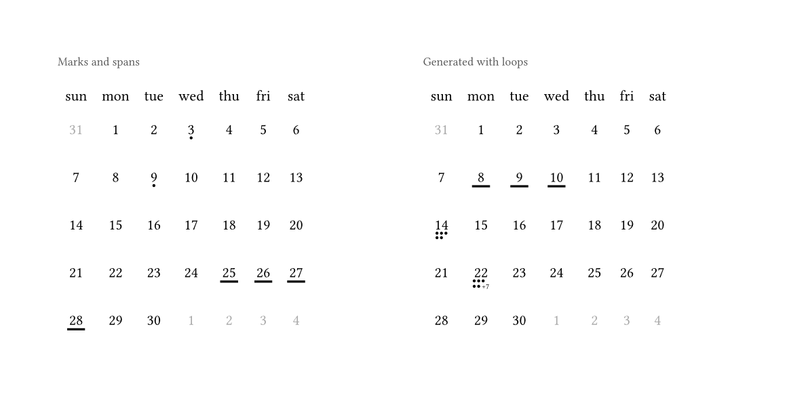

```typst
// Marks and spans
#import "calendar.typ": calendar, mark, span, month-weeks
#let c1 = calendar({
  mark((day: 3), label: "Exam")
  mark((day: 9), label: "Dentist")
  span((day: 25), (day: 28), label: "Trip")
}, default: (year: 2024, month: 4))
#month-weeks(c1)

// Generated with loops
#let c2 = calendar({
  for i in range(5) { mark((day: 14), label: "Meeting") }
  for i in range(12) { mark((day: 22), label: "Task") }
  span((day: 8), (day: 10), label: "Sprint")
}, default: (year: 2024, month: 4))
#month-weeks(c2)
```

---

### Declaring data: event kinds with colors, and events built from a list

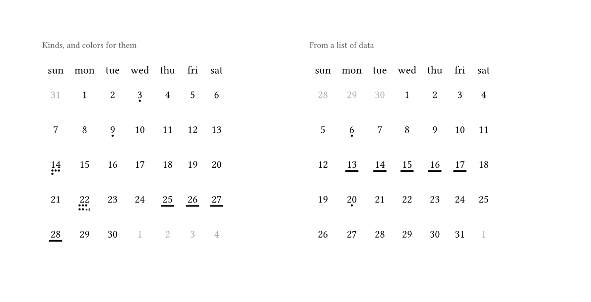

```typst
// Kinds, and colors for them
#let colors = (school: blue, health: green, work: orange)
#let c3 = calendar({
  mark((day: 3), label: "Exam", kind: "school")
  mark((day: 9), label: "Dentist", kind: "health")
  for _ in range(4) { mark((day: 14), kind: "work") }
  for _ in range(8) { mark((day: 22), kind: "work") }
  mark((day: 22), label: "Checkup", kind: "health")
  span((day: 25), (day: 28), label: "Trip")
}, default: (year: 2024, month: 4))
#month-weeks(c3)

// From a list of data
#let birthdays = ((6, "Ana"), (20, "Bruno"))
#let c4 = calendar({
  for (d, who) in birthdays {
    mark((day: d), label: who)
  }
  span((day: 13), (day: 17), label: "Conference")
}, default: (year: 2024, month: 5))
#month-weeks(c4)
```

---

### Presetting options with `.with`: a house style and a minimal look

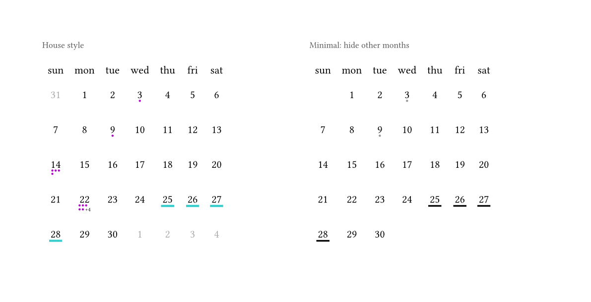

```typst
// House style
#let view = month-weeks.with(
  mark-fill: purple,
  span-stroke: 0.2em + teal,
)
#view(c3)

// Minimal: hide other months
#let view = month-weeks.with(
  off-month-fill: white,
  mark-fill: luma(150),
)
#view(c1)
```

---

### `week-height`: rows that fit their content vs. compact fixed rows

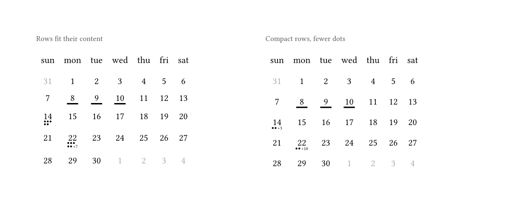

```typst
// Rows fit their content
#month-weeks(c2, week-height: auto)

// Compact rows, fewer dots
#month-weeks(c2, week-height: 2.2em, max-marks: 3)
```

---

### `marks-grid-args`: laying out the dots in a row or in a column

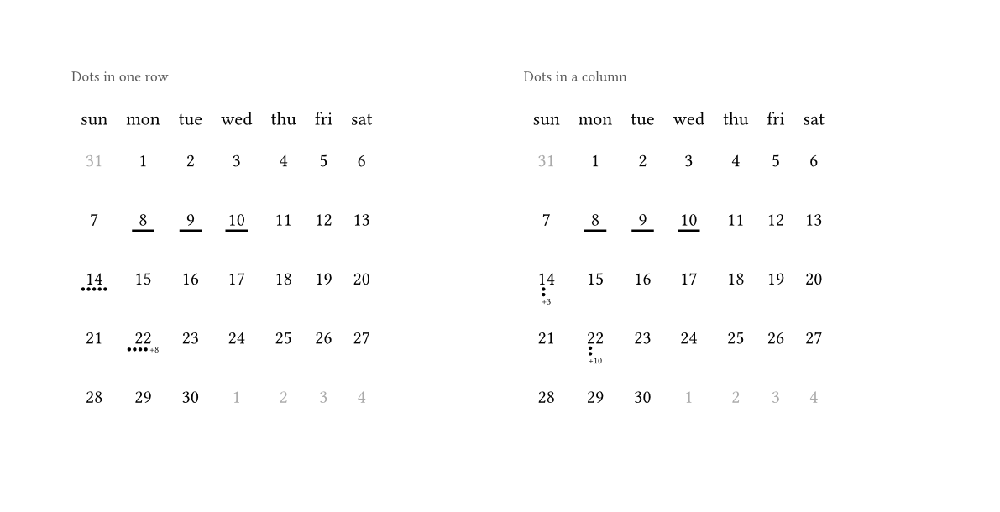

```typst
// Dots in one row
#month-weeks(c2, max-marks: 5,
  marks-grid-args: n => (columns: calc.min(n, 5)))

// Dots in a column
#month-weeks(c2, max-marks: 3,
  marks-grid-args: (columns: 1))
```

---

### `render-marks`: dots colored by kind, and the first event label

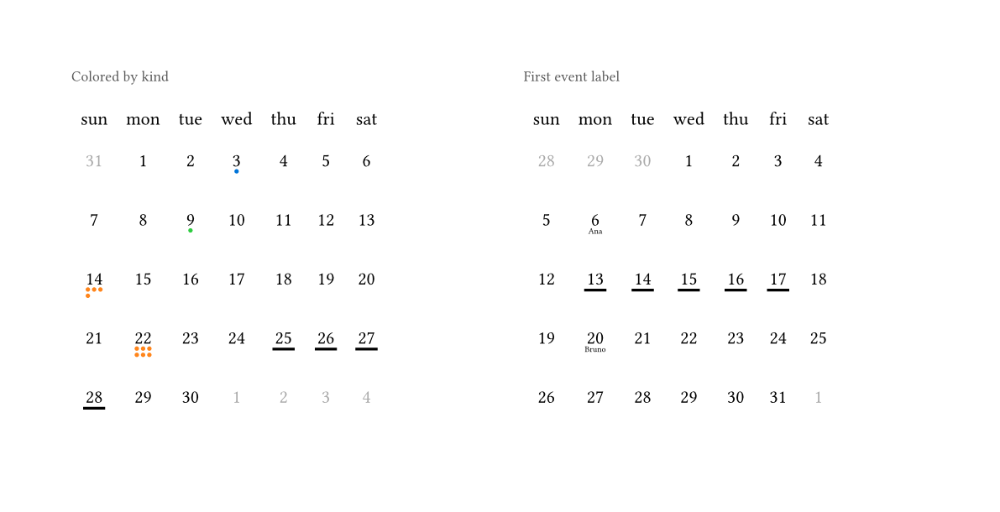

```typst
// Colored by kind
#let dot(e) = circle(
  radius: 0.12em, fill: colors.at(e.kind))
#month-weeks(c3, render-marks: (dots, events, args) => {
  let shown = events.slice(0, calc.min(6, events.len()))
  grid(..args, ..shown.map(dot))
})

// First event label
#month-weeks(c4, render-marks: (dots, events, args) => {
  if events.len() > 0 {
    text(size: 0.45em, events.first().label)
  }
})
```

---

### `render-marks`: a count badge and a busyness bar per day

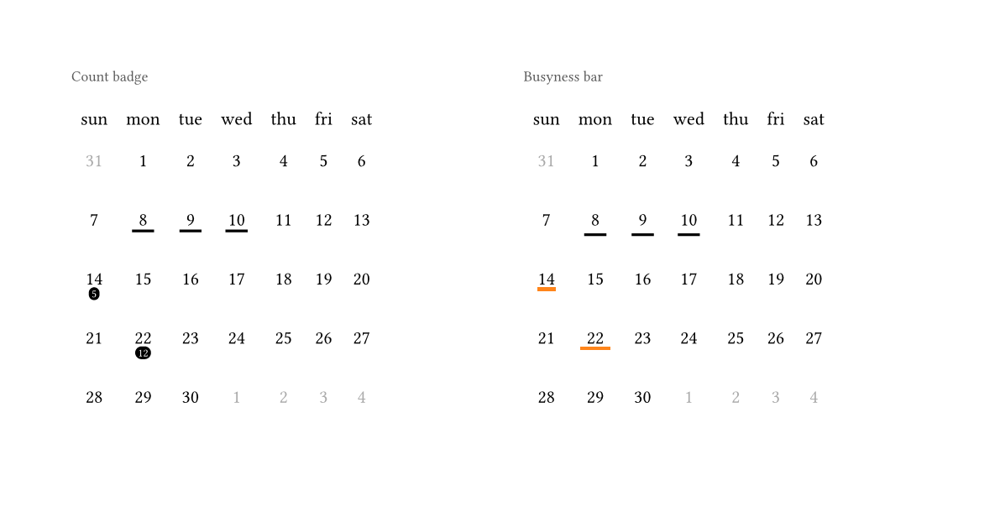

```typst
// Count badge
#month-weeks(c2, render-marks: (dots, events, args) => {
  if events.len() > 0 {
    box(fill: black, inset: 0.15em, radius: 0.5em,
      text(fill: white, size: 0.6em)[#events.len()])
  }
})

// Busyness bar
#month-weeks(c2, render-marks: (dots, events, args) => {
  let n = calc.min(events.len(), 8)
  rect(width: n * 0.2em, height: 0.2em, fill: orange)
})
```

---

### `weekday-names` and `first-weekday`: Portuguese with monday first, and single letters

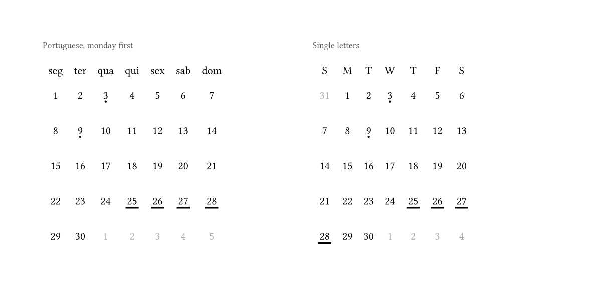

```typst
// Portuguese, monday first
#let pt = ("dom", "seg", "ter", "qua",
  "qui", "sex", "sab")
#month-weeks(c1, weekday-names: pt, first-weekday: 1)

// Single letters
#month-weeks(c1,
  weekday-names: ("S", "M", "T", "W", "T", "F", "S"))
```

---

### `render-header`: red weekends, and no header at all

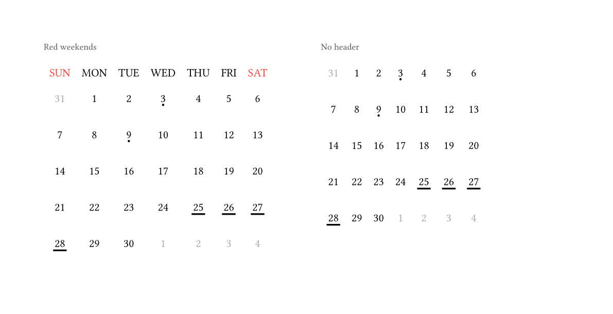

```typst
// Red weekends
#month-weeks(c1, render-header: (i, name) => {
  let fill = if i in (0, 6) { red } else { black }
  pad(bottom: 0.6em, text(fill: fill, upper(name)))
})

// No header
#month-weeks(c1, render-header: (i, name) => none)
```

---

### `grid-args`: a bordered table and shaded weekends

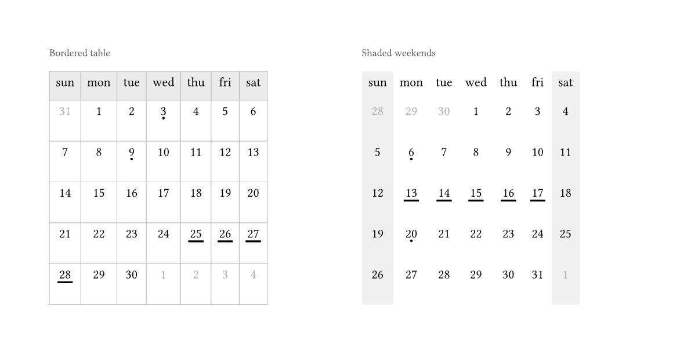

```typst
// Bordered table
#month-weeks(c1, grid-args: (
  stroke: 0.5pt + luma(180),
  fill: (x, y) => if y == 0 { luma(235) },
))

// Shaded weekends
#month-weeks(c4, grid-args: (
  fill: (x, y) => if x in (0, 6) { luma(240) },
))
```

---

### `month` and `year`: a leap february next to the following year's

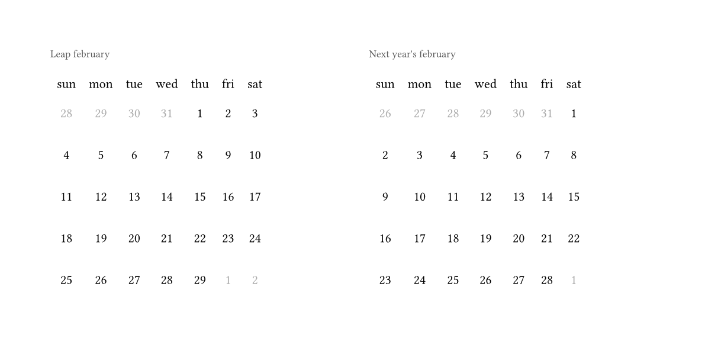

```typst
// Leap february
#month-weeks(c1, month: 2)

// Next year's february
#month-weeks(c1, month: 2, year: 2025)
```

---

### `filter-events`: only work events, and only the 10th to the 25th

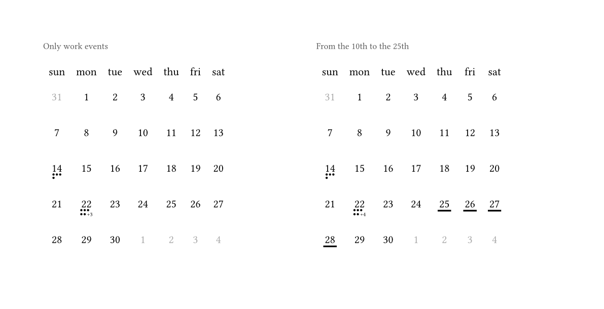

```typst
// Only work events
#month-weeks(filter-events(c3, kind: "work"))

// From the 10th to the 25th
#month-weeks(filter-events(c3,
  between: ((day: 10), (day: 25))))
```

---

### Other views from the same data: an agenda and a count per kind

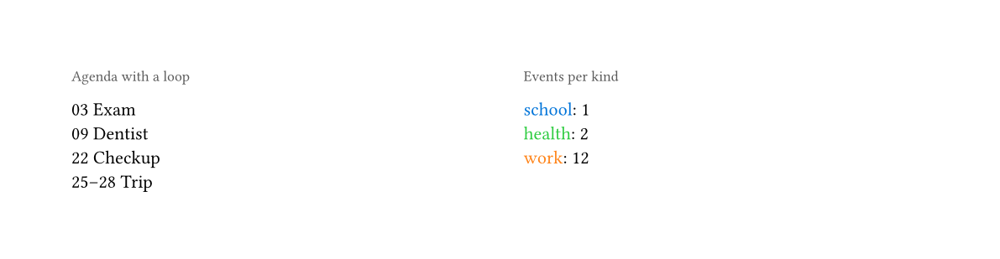

```typst
// Agenda with a loop
#let april = filter-events(c3,
  where: e => e.kind != "work")
#for m in april.marks [
  #m.date.display("[day]") #m.label \
]
#for s in april.spans [
  #s.start.display("[day]")–#s.end.display("[day]")
  #s.label \
]

// Events per kind
#for k in colors.keys() [
  #text(fill: colors.at(k), k):
  #filter-events(c3, kind: k).marks.len() \
]
```
